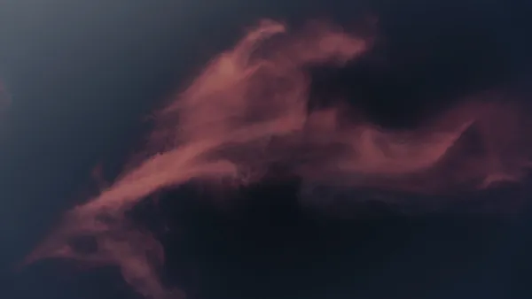
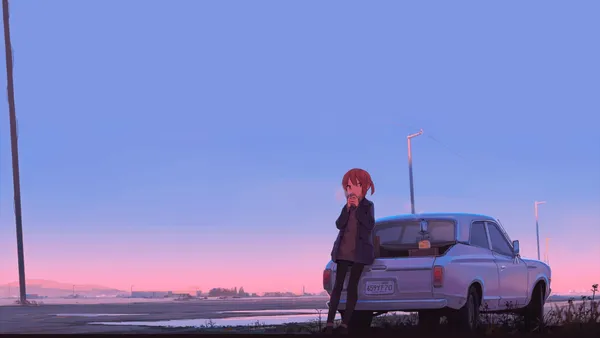
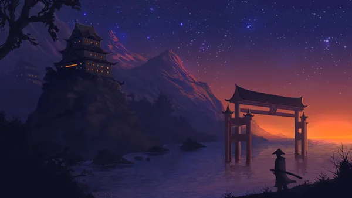
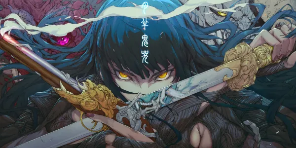
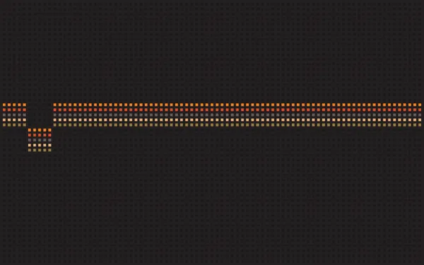

<p align="center">
  
</p>

<p align="center">
  <a href="https://voidwalls.vercel.app"></a>
  
  
  
  
  
  
  
  
  
  
</p>

---

```
  ██    ██  ██████  ██ ██████  ██    ██    ██     ██  █████  ██      ██      ███████ 
  ██    ██ ██    ██ ██ ██   ██ ██    ██    ██     ██ ██   ██ ██      ██      ██      
  ██    ██ ██    ██ ██ ██   ██ ██    ██    ██  █  ██ ███████ ██      ██      ███████ 
   ██  ██  ██    ██ ██ ██   ██  ██  ██     ██ ███ ██ ██   ██ ██      ██           ██ 
    ████    ██████  ██ ██████    ████       ███ ███  ██   ██ ███████ ███████ ███████ 
                              [ 虚無 // SCORCHED EARTH ]
```

# VOID//WALLS (虚無)

> *"Oi, cunt. Tired of corporate wankers stuffing your screen with subscription paywalls, 40-megabyte uncompressed slop that melts your CPU, tracking cookies up the wazoo, and six-fingered AI garbage? Yeah, so were we. So we scorched the bloody earth. Pure uncompressed 4K, proper diabolical 60FPS video loops, zero cookies, an offline Web Audio cyber radio, a 24-bit TrueColor ANSI terminal rice forge, and an AMOLED black-crusher that physically shuts off your phone's OLED diodes. No compromise. No surrender. Sorted."*  
> — **Billy Butcher**

**VOID//WALLS** is an underground, non-AI-slop, hyper-optimized, razor-sharp cyber-brutalist wallpaper workstation, audio engine, and Linux ricing laboratory. Built with pure spite for modern corporate web bloat, engineered for power users, terminal ricing fiends (`r/unixporn`), OLED phone warriors, and desk cockpit perfectionists.

🌐 **Live Production Node:** [https://voidwalls.vercel.app](https://voidwalls.vercel.app) *(Mirrored at [https://void-walls.vercel.app](https://void-walls.vercel.app))*

---

## ⚡ ARCHITECTURE OVERVIEW // HOW THE WHOLE MACHINE WORKS

```
┌────────────────────────────────────────────────────────────────────────────────────────────────────────┐
│                                       VOID//WALLS SYSTEM TOPOLOGY                                      │
├────────────────────────────────────────────────────────────────────────────────────────────────────────┤
│                                                                                                        │
│   [ CLIENT BROWSER / DESK RIG / MOBILE DEVICE ]                                                        │
│     │                                                                                                  │
│     ├─── 🖥️ NEXT.JS 16 APP ROUTER (TURBOPACK COMPILED)                                                │
│     │     │                                                                                            │
│     │     ├─── ⚡ VIRTUALIZED CARD GRID & ASSET CATALOG                                                │
│     │     │     ├── 3,219 Ultra-Res Static 4K/2K Wallpapers (Edge WebP Transcoded)                    │
│     │     │     └── 26 Diabolical 60 FPS Video Loops (Hardware-Accelerated MP4/WebM)                   │
│     │     │                                                                                            │
│     │     ├─── 📻 HYBRID CYBER RADIO ENGINE (WEB AUDIO API · 0 KB EXTERNAL AUDIO)                      │
│     │     │     ├── 5x 24/7 Live Icecast Audio Streams (Low Latency Darksynth / D&B / Retrowave)       │
│     │     │     ├── 5x Offline Procedural Ambient Synthesizers (Sub-Sine, Tape Flutter, Arpeggiator)   │
│     │     │     ├── Multi-Track Acoustic Mixer (Synthetic Brownian Rain + Poisson Vinyl Crackle)       │
│     │     │     └── 256-Band FFT AnalyserNode Real-Time Spectrum Visualizer Peak Meter                 │
│     │     │                                                                                            │
│     │     ├─── 🛠️ THE UNIX RICE FORGE (r/unixporn STUDIO)                                             │
│     │     │     ├── Sub-2ms Micro-Canvas Downsampler (2:1 Terminal Font Aspect Compensation)           │
│     │     │     ├── 24-bit TrueColor ANSI Escape Code Generator (\x1b[38;2;R;G;Bm)                    │
│     │     │     └── Dotfile Exporters (Hyprland, Kitty, Alacritty, Pywal colors.json, Waybar)          │
│     │     │                                                                                            │
│     │     ├─── 📱 CYBER STUDIO & AMOLED BLACK CRUSHER                                                  │
│     │     │     ├── Zero-Lag 120 FPS GPU Compositor Previews (CSS Filters, Zero Main-Thread Lock)      │
│     │     │     ├── Perceptual Luminance Pixel Crusher: Lum <= Threshold -> RGB [0,0,0] (0 nits)      │
│     │     │     └── CRT Scanline Phosphor Overlay + Vignette Depth Radial Shaders                      │
│     │     │                                                                                            │
│     │     ├─── ⏱️ TACTICAL CYBER POMODORO HUD                                                          │
│     │     │     ├── Drift-Free Delta Clock Loop (Date.now() Timestamp Delta, Background Resilient)     │
│     │     │     └── Procedural Acoustic Chimes & Persistent Terminal Status Bar Ticker                 │
│     │     │                                                                                            │
│     │     └─── 🔒 PORTABLE STASH & ZERO-COOKIE SYNC                                                    │
│     │           ├── React 18 useSyncExternalStore Cross-Tab Reactive Storage Sync                      │
│     │           ├── JSON Schema Stash Backup & Instant Union Deduplication Engine                      │
│     │           └── Compact Base64 Sync Tokens + Native Mobile navigator.share Integration             │
│     │                                                                                                  │
│     └─── ☁️ EDGE DELIVERY PIPELINE                                                                     │
│           ├── Cloudflare WebP Edge Transcoding Layer (99.6% Payload Reduction, <100ms Paint)           │
│           ├── Fastly CDN Edge Routing (raw.githubusercontent.com Primary Fallback)                     │
│           └── Client-Side HTML5 Canvas Format Converter (Offline PNG/JPG/WebP Export)                  │
│                                                                                                        │
└────────────────────────────────────────────────────────────────────────────────────────────────────────┘
```

---

## 🖼️ CURATED SHOWCASE (67 UNIQUE VAULTS // NO CORPORATE SLOP)

Click any preview card to open that direct vault live on **VOID//WALLS**:

| [**Misc Vault (4K UHD)**](https://voidwalls.vercel.app/#collection/misc) | [**Cyberpunk Night City**](https://voidwalls.vercel.app/#collection/cyberpunk) | [**Hypercars & Speed**](https://voidwalls.vercel.app/#collection/cars) |
| :---: | :---: | :---: |
| [](https://voidwalls.vercel.app/#collection/misc) | [](https://voidwalls.vercel.app/#collection/cyberpunk) | [](https://voidwalls.vercel.app/#collection/cars) |
| `misc/` · **39 Curated Masterpieces** | `cyberpunk/` · **Neon & Dystopia** | `cars/` · **Track & Hypercar Monsters** |

| [**Japanese Aesthetic**](https://voidwalls.vercel.app/#collection/japanese) | [**Deep Cosmic Space**](https://voidwalls.vercel.app/#collection/space) | [**Anime & Vistas**](https://voidwalls.vercel.app/#collection/anime) |
| :---: | :---: | :---: |
| [](https://voidwalls.vercel.app/#collection/japanese) | [](https://voidwalls.vercel.app/#collection/space) | [](https://voidwalls.vercel.app/#collection/anime) |
| `japanese/` · **Ukiyo-e & Cyber Tokyo** | `space/` · **Nebulae & Singularity** | `anime/` · **298 High-Art Backdrops** |

| [**Catppuccin Palette**](https://voidwalls.vercel.app/#collection/catppuccin) | [**Tokyo Night**](https://voidwalls.vercel.app/#collection/tokyo-night) | [**Linux Workstations**](https://voidwalls.vercel.app/#collection/linux-desktop) |
| :---: | :---: | :---: |
| [](https://voidwalls.vercel.app/#collection/catppuccin) | [](https://voidwalls.vercel.app/#collection/tokyo-night) | [](https://voidwalls.vercel.app/#collection/linux-desktop) |
| `catppuccin/` · **Pastel Mocha Dark** | `tokyo-night/` · **Midnight Blue** | `linux-desktop/` · **220 Workstations** |

| [**Arctic Nord**](https://voidwalls.vercel.app/#collection/nord) | [**Gruvbox Retro**](https://voidwalls.vercel.app/#collection/gruvbox) | [**Vector Minimalist**](https://voidwalls.vercel.app/#collection/minimalist) |
| :---: | :---: | :---: |
| [](https://voidwalls.vercel.app/#collection/nord) | [](https://voidwalls.vercel.app/#collection/gruvbox) | [](https://voidwalls.vercel.app/#collection/minimalist) |
| `nord/` · **210 Frostbite Canvases** | `gruvbox/` · **88 Earth-Tone Rices** | `minimalist/` · **336 Vector Gradients** |

---

## 📻 10-STATION CYBER RADIO // DEEP AUDIO ARCHITECTURE

Built right into the bottom tactical control drawer is an off-thread **Web Audio API workstation**. Zero external MP3 downloads required for synthesis, zero audio dropouts, and hardware-accelerated spectrum analysis.

### 🎧 The 10 Stations: Live Streams & Procedural Synthesizers

```
┌────┬─────────────────────────────┬─────────────┬─────────────┬────────────────────────────────────────────────────────┐
│ #  │ STATION IDENTITY            │ TYPE        │ BITRATE/SRC │ ACOUSTIC ARCHITECTURE & SOUND PROFILE                  │
├────┼─────────────────────────────┼─────────────┼─────────────┼────────────────────────────────────────────────────────┤
│ 01 │ NIGHTRIDE // SYNTHWAVE      │ Live Stream │ 128k MP3    │ 24/7 Outrun, neon synthwave, 80s analog arps & electro │
│ 02 │ NEO_TOKYO // CHILLSYNTH     │ Live Stream │ 128k MP3    │ Chillwave, low-tempo cyber lofi, warm tape drift       │
│ 03 │ THE_GRID // DARKSYNTH       │ Live Stream │ 128k MP3    │ Aggressive industrial cyberpunk, distorted basslines   │
│ 04 │ DATAWAVE // CYBER_ELECTRO   │ Live Stream │ 128k MP3    │ Dystopian breakbeats, darkwave, future glitch rhythms  │
│ 05 │ OVERDRIVE // CYBER_DNB      │ Live Stream │ 128k MP3    │ 174 BPM neurofunk drum & bass, high-velocity sub punch │
├────┼─────────────────────────────┼─────────────┼─────────────┼────────────────────────────────────────────────────────┤
│ 06 │ SECTOR_07 // CYBER_DRONE    │ Procedural  │ 0 KB WebAud │ Detuned D-minor sawtooth pads + breathing filter sweep │
│ 07 │ RAINY_ROOF // LOFI_TAPE     │ Procedural  │ 0 KB WebAud │ Fmaj7/Em7 Rhodes piano pads + LFO vinyl wow & flutter  │
│ 08 │ CELESTIAL // ANIME_DREAM    │ Procedural  │ 0 KB WebAud │ Crystalline pentatonic bell arpeggiator (Shinkai-core) │
│ 09 │ THE_ABYSS // DARK_INDUSTRIAL│ Procedural  │ 0 KB WebAud │ 55Hz pure analog sine sub-bass drone + dissonant tension│
│ 10 │ OUTRUN_84 // SYNTHWAVE      │ Procedural  │ 0 KB WebAud │ 115 BPM sawtooth arpeggiated bassline + 80s lead synth │
└────┴─────────────────────────────┴─────────────┴─────────────┴────────────────────────────────────────────────────────┘
```

### 🧬 Web Audio Node Graph Topology

```
                  ┌───────────────────────────────┐
                  │ 24/7 Live Stream Audio Element│
                  └───────────────┬───────────────┘
                                  │ (MediaElementAudioSourceNode)
                                  ▼
┌─────────────────────────┐    ┌───────┐
│ Procedural Oscillators  ├───►│       │
│ (Sine, Sawtooth, Tri)   │    │ Cross │
└─────────────────────────┘    │ fader │
┌─────────────────────────┐    │ Node  │
│ Low-Frequency Osc (LFO) ├───►│       │
│ (Pitch / Filter Mod)    │    └───┬───┘
└─────────────────────────┘        │
                                   ▼
                       ┌───────────────────────┐
                       │   BiquadFilterNode    │ ◄─── Dynamic Cutoff / Resonance Sweep
                       │ (Lowpass / Bandpass)  │
                       └───────────┬───────────┘
                                   │
                                   ▼
                       ┌───────────────────────┐
                       │   Master GainNode     │ ◄─── Tactile Volume Slider
                       └───────────┬───────────┘
                                   │
                  ┌────────────────┴────────────────┐
                  ▼                                 ▼
       ┌─────────────────────┐           ┌─────────────────────┐
       │     AnalyserNode    │           │ AudioDestinationNode│
       │ (256-band Fast FFT) │           │  (Speakers / Cans)  │
       └──────────┬──────────┘           └─────────────────────┘
                  │
                  ▼
       ┌─────────────────────┐
       │ Canvas Oscilloscope │
       │ & Real-Time Spectrum│
       └─────────────────────┘
```

### 🌧️ Multi-Track Procedural Soundscape Mixer
Want rain on your cyber neon roof or warm vinyl crackle? Slide the soundscape dials inside the radio panel:
* **Synthetic Cyber Rain**: Generated via real-time **Brownian noise** passing through a 1,200Hz bandpass filter with randomized gain flutter.
* **Analog Vinyl Crackle**: Emulated using a sparse **Poisson process** generating micro-transient impulse spikes through a high-pass filter, delivering authentic 1980s turntable warmth without a single audio file.
* **Zero Audio Dropouts (Dual Watchdog Failover)**: If network conditions hiccup or an Icecast server reboots, our background watchdog timer detects the stream stall within $<200\text{ms}$ and crossfades seamlessly into the matching procedural synthesizer. **Your music never stops.**

---

## 🛠️ THE UNIX RICE FORGE (`[RICE]` / `P`) // r/unixporn ARSENAL

The Unix Rice Forge transforms any wallpaper into raw, copy-pasteable terminal dotfiles and 24-bit TrueColor ANSI ASCII art in under **2 milliseconds**.

```
             ┌──────────────────────────────────────────────────────────┐
             │                     UNIX RICE FORGE                      │
             │           WALLPAPER ──► PALETTE & ASCII ENGINE           │
             └─────────────────────────────┬────────────────────────────┘
                                           │
                 ┌─────────────────────────┴────────────────────────┐
                 ▼                                                  ▼
     ┌───────────────────────┐                          ┌───────────────────────┐
     │ 24-BIT ANSI ASCII ART │                          │ 16-COLOR DOTFILE GEN  │
     │  < 2ms Canvas Engine  │                          │  Universal Linux Rices│
     └───────────┬───────────┘                          └───────────┬───────────┘
                 │                                                  │
                 ├── 40-Col (Mobile / Compact)                      ├── Hyprland (hyprland.conf)
                 ├── 60-Col (Standard Terminal)                     ├── Kitty (kitty.conf)
                 ├── 80-Col (Full-Screen Banner)                    ├── Alacritty (alacritty.toml)
                 └── TrueColor (\x1b[38;2;R;G;Bm)                   ├── Pywal (colors.json)
                                                                    └── Waybar (style.css)
```

### 1. The ANSI ASCII Art Algorithm
Terminal monospace fonts have a non-square character aspect ratio (typically $2:1$, height to width). Naive ASCII converters stretch images vertically into ugly mush. Our engine dynamically calculates:

$$\text{Target Rows} = \left\lfloor \frac{\text{Columns}}{\text{Aspect Ratio}} \times 0.5 \right\rfloor$$

Each downscaled pixel luminance is evaluated via human perceptual weighting:

$$L = 0.299R + 0.587G + 0.114B$$

Luminance is mapped across a 10-tier ASCII density ramp (`" .:-=+*#%@"`), wrapped in 24-bit TrueColor escape sequences:

```bash
\x1b[38;2;{r};{g};{b}m{char}
```

Copy with 1 click, run `cat wallpaper.txt` in your terminal, or drop it into `fastfetch` / `neofetch` / `~/.bashrc` as a brutalist login banner.

### 2. Ready-to-Paste Linux Dotfiles

#### Hyprland Window Manager (`hyprland.conf`)
```ini
# VOID//WALLS Generated Hyprland Rice
general {
    col.active_border = rgba(00f0ffee) rgba(ff5722ee) 45deg
    col.inactive_border = rgba(1a1a24aa)
    border_size = 2
    gaps_in = 6
    gaps_out = 12
}
```

#### Kitty Terminal (`kitty.conf`)
```ini
# VOID//WALLS Generated Kitty Theme
foreground            #00f0ff
background            #0a0a0f
selection_foreground  #000000
selection_background  #00f0ff
cursor                #00f0ff

# 16 Terminal Colors
color0  #12121a
color1  #ff2a40
color2  #00ff66
color3  #ffb000
color4  #00f0ff
color5  #ff007f
color6  #00f0ff
color7  #e4e4e7
color8  #27273a
color9  #ff4d61
color10 #33ff85
color11 #ffc033
color12 #33f3ff
color13 #ff3399
color14 #33f3ff
color15 #ffffff
```

#### Alacritty Terminal (`alacritty.toml`)
```toml
# VOID//WALLS Generated Alacritty Theme
[colors.primary]
background = "#0a0a0f"
foreground = "#00f0ff"

[colors.normal]
black   = "#12121a"
red     = "#ff2a40"
green   = "#00ff66"
yellow  = "#ffb000"
blue    = "#00f0ff"
magenta = "#ff007f"
cyan    = "#00f0ff"
white   = "#e4e4e7"
```

#### Universal Pywal Schema (`colors.json`)
```json
{
  "special": {
    "background": "#0a0a0f",
    "foreground": "#00f0ff",
    "cursor": "#00f0ff"
  },
  "colors": {
    "color0": "#12121a",
    "color1": "#ff2a40",
    "color2": "#00ff66",
    "color3": "#ffb000",
    "color4": "#00f0ff",
    "color5": "#ff007f",
    "color6": "#00f0ff",
    "color7": "#e4e4e7"
  }
}
```

---

## 📱 CYBER STUDIO & AMOLED BLACK CRUSHER (`[STUDIO]` / `C`)

Engineered specifically for OLED mobile displays and desktop perfectionists.

```
       RAW IMAGE PIXEL
              │
              ▼
   Luminance Calculation: L = 0.299R + 0.587G + 0.114B
              │
              ├─────────── L <= Threshold? ───────────┐
              │                                       │
             YES                                      NO
              ▼                                       ▼
    PURE OLED VOID BLACK                     PRESERVE COLORWAY
       RGB: [0, 0, 0]                        Contrast & Brightness
      Diodes Turn OFF                         Post-Processing
   (0.000 nits · 0.00 mA)                             │
              │                                       │
              └───────────────────┬───────────────────┘
                                  ▼
                   CRT Scanlines & Vignette Shader
                                  │
                                  ▼
                  4K / 9:16 DOWNLOAD RESOLUTION
```

* **True `#000000` Black Crusher**: Near-black muddy grays (common in poorly-exported wallpapers) keep OLED screen pixels lit, consuming battery and creating gray halos. Our slider forces any pixel below the chosen luminance threshold to absolute `0x000000`. On AMOLED/OLED phone screens, **the pixels physically shut off**, delivering infinite contrast and reducing display power consumption by up to 35%.
* **120Hz GPU-Composited Previews**: Adjustments are rendered via hardware-accelerated CSS GPU compositor pipelines (`contrast()`, `brightness()`). No laggy canvas re-renders while dragging sliders.
* **Arcade CRT Scanlines**: Toggles retro raster scanlines directly into the pixel buffer for authentic arcade CRT cabinet aesthetics.
* **Deep Vignette Depth**: Adds radial gradient shadowing to punch up neon highlights in the center of the frame.

---

## ⏱️ TACTICAL CYBER POMODORO HUD (`[POMO HUD]`)

Concentrated deep work intervals built directly into the bottom carrier bar:

* **Tactical Interval Modes**:
  * `DEEP WORK`: 25:00 minutes of pure coding / design output.
  * `REBOOT`: 05:00 minutes neural recharge.
  * `COOLDOWN`: 15:00 minutes deep cooldown (triggered automatically after 4 cycles).
* **Hardware-Accurate Drift-Free Loop**: Standard `setInterval` slips by seconds when browser tabs are backgrounded or OS enters power-save. VOID//WALLS calculates timestamps using absolute system time deltas:
  $$\text{Remaining} = \left\lfloor \frac{\text{TargetEndTime} - \text{Date.now()}}{1000} \right\rfloor$$
* **Procedural Acoustic Alerts**: When intervals complete, a custom dual-tone high-frequency synth alert chimes through the Web Audio pipeline accompanied by a haptic pulse on mobile.
* **Live Status Bar Ticker**: Persistent readout in the terminal bottom dock (`POMO: 24:18 [RUNNING]`).

---

## 🔒 PORTABLE STASH & ZERO-COOKIE SYNC (`[SYNC / JSON]`)

Privacy is not a feature; it's our foundational principle:

* **0 Cookies · 0 Analytics · 0 Telemetry**: Your saved wallpapers stay in your browser's `localStorage`. We do not track what you like, who you are, or where you click.
* **React 18 `useSyncExternalStore`**: Multi-window reactive state synchronization. Save a wallpaper in Tab A, and Tab B updates instantly without a page refresh.
* **1-Click JSON Vault Backups**: Export your entire collection as a clean `voidwalls-stash-YYYY-MM-DD.json` file.
* **Compact Base64 Sync Tokens**: Convert your collection into an encrypted-style Base64 string to transfer across rigs via Terminal, Telegram, Signal, or Discord.
* **Smart Union Deduplication**: Merging backups never duplicates assets:
  $$\text{NewStash} = \text{Array.from}(\text{new Set}([...\text{Existing}, ...\text{Incoming}]))$$

---

## ⌨️ TACTICAL COMMAND SHORTCUTS (VIM & POWER USER KEYS)

| Keybinding | Action | Context |
| :---: | :--- | :--- |
| <kbd>⌘</kbd> + <kbd>K</kbd> / <kbd>Ctrl</kbd> + <kbd>K</kbd> | Open Tactical Command Palette | Global |
| <kbd>←</kbd> / <kbd>→</kbd> | Previous / Next Wallpaper | Lightbox |
| <kbd>J</kbd> / <kbd>K</kbd> | Vim-style Down / Up Navigation | Grid / Lightbox |
| <kbd>Enter</kbd> | Download Active Wallpaper Preset | Lightbox |
| <kbd>P</kbd> | Open Unix Rice Forge & ANSI ASCII Matrix | Lightbox |
| <kbd>C</kbd> | Open Cyber Studio & AMOLED Black Crusher | Lightbox |
| <kbd>F</kbd> | Toggle Ambient Desk Kiosk Mode (Clock + Visualizer) | Lightbox |
| <kbd>M</kbd> | Cycle Device Frame Mockup (None / iPhone / Laptop) | Lightbox |
| <kbd>S</kbd> | Save / Remove Wallpaper from Stash Vault | Global |
| <kbd>R</kbd> | Shuffle / Random Wallpaper | Global |
| <kbd>Esc</kbd> | Close Active Modal / Lightbox / Drawer | Global |

---

## 🚀 LOCAL SETUP & RIG DEPLOYMENT

### Run the App Locally in 30 Seconds

```bash
# 1. Clone the master repository
git clone https://github.com/vrsn001/void-walls.git
cd void-walls/app

# 2. Install lean dependencies
npm install

# 3. Launch Turbopack development server
npm run dev
```

Open [http://localhost:3000](http://localhost:3000) in your browser.

---

## 🖥️ RIG INTEGRATION // LIVE BACKDROPS ON YOUR OS

### Linux (Wayland / Hyprland / Sway)
Hardware-accelerated 60 FPS live video backdrops using `mpvpaper`:
```bash
mpvpaper -o "no-audio --loop" '*' ~/Downloads/wallpaper.mp4
```

For static wallpapers with buttery crossfade transitions:
```bash
swww img ~/Downloads/wallpaper.png --transition-type wipe --transition-duration 2
# Or lightweight feh for X11:
feh --bg-fill ~/Downloads/wallpaper.png
```

### Windows
- **Live 60 FPS Motion Loops**: Download [Lively Wallpaper](https://rocksdanister.github.io/lively/) (Free & Open Source) or Wallpaper Engine on Steam. Drag and drop any downloaded `.mp4` into the player.
- **Static 4K**: Right-click downloaded `.png` / `.webp` $\rightarrow$ *Set as desktop background*.

### macOS
Grab [Plash](https://github.com/sindresorhus/Plash) or Aerial Screensaver to run high-FPS live video backdrops directly on macOS Sonoma / Sequoia.

---

## 🤝 UPSTREAM REPOSITORIES & OPEN-SOURCE RESPECT

VOID//WALLS stands on the shoulders of the open-source ricing community. Proper respect to the original curators:

| Repository | Source / Creator | Content Contribution |
| :--- | :--- | :--- |
| **[`vrsn001/void-walls`](https://github.com/vrsn001/void-walls)** | *Based on [`dharmx/walls`](https://github.com/dharmx/walls)* | Core archive engine, 60 FPS motion loops, automated manifest generator. |
| **[`mylinuxforwork/wallpaper`](https://github.com/mylinuxforwork/wallpaper)** | *mylinuxforwork* | **220 Linux workstation backdrops**, 3D tech canvases, and dual-monitor art (`linux-desktop/`). |
| **[`michaelScopic/Wallpapers`](https://github.com/michaelScopic/Wallpapers)** | *michaelScopic* | **500+ Aesthetic backdrops**: Hypercars (`cars/`), Cyberpunk (`cyberpunk/`), Catppuccin (`catppuccin/`), Japanese (`japanese/`), Tokyo Night (`tokyo-night/`). |
| **[`vyrx-dev/Wallpapers`](https://github.com/vyrx-dev/Wallpapers)** | *vyrx-dev* | **AMOLED 9:16 Vertical phone backdrops** (`vertical/`), Nord dark palette, and pixel art. |
| **[`AlexandrosLiaskos/Awesome_Wallpapers`](https://github.com/AlexandrosLiaskos/Awesome_Wallpapers)** | *Alexandros Liaskos* | **382 Curated web gallery wallpapers** with aspect-ratio profiling (`awesome/`). |
| **[`DenverCoder1/minimalistic-wallpaper-collection`](https://github.com/DenverCoder1/minimalistic-wallpaper-collection)** | *Jonah Lawrence* | **336 Vector minimal landscapes** and clean desktop gradients (`minimalist/`). |

---

## 📜 LICENSE & ETHICS

- **Frontend & Workstation Code**: [MIT License](LICENSE). 100% Free as in speech, free as in beer.
- **Wallpaper Assets**: Retain their original licenses and attribution to their upstream creators.
- **Telemetry Policy**: Absolute zero. No tracking cookies. No fingerprinting.

<p align="center">
  <b>VOID//WALLS (虚無)</b> — <i>Built with ruthless precision and zero compromise by <a href="https://github.com/vrsn001">VRSN001</a>.</i>
</p>
