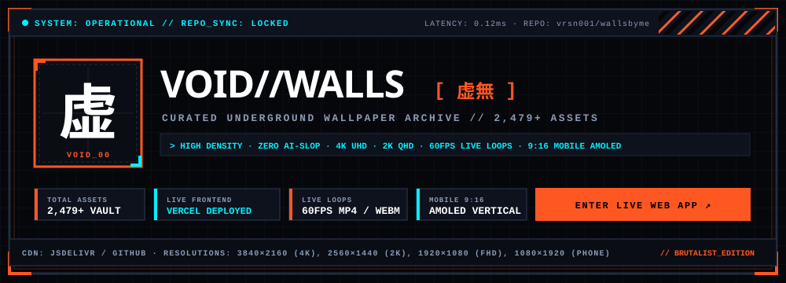

<p align="center">
  
</p>

<p align="center">
  <a href="https://void-walls.vercel.app"></a>
  
  
  
  
</p>

---

```
  ██    ██  ██████  ██ ██████  ██    ██    ██     ██  █████  ██      ██      ███████ 
  ██    ██ ██    ██ ██ ██   ██ ██    ██    ██     ██ ██   ██ ██      ██      ██      
  ██    ██ ██    ██ ██ ██   ██ ██    ██    ██  █  ██ ███████ ██      ██      ███████ 
   ██  ██  ██    ██ ██ ██   ██  ██  ██     ██ ███ ██ ██   ██ ██      ██           ██ 
    ████    ██████  ██ ██████    ████       ███ ███  ██   ██ ███████ ███████ ███████ 
                               [ 虚無 ARCHIVE ]
```

# VOID//WALLS (虚無)

**Curated Underground Wallpaper Vault // 2,479+ Ultra-High-Density Desktop & Mobile Assets**

A non-AI-slop, hyper-optimized, raw cyber-brutalist wallpaper repository and interactive frontend. Built for power users, ricing enthusiasts, designers, and developers.

> **🌐 Live Production Web App:** [https://void-walls.vercel.app](https://void-walls.vercel.app) (also [https://voidwalls.vercel.app](https://voidwalls.vercel.app))

---

## ⚡ CORE SPECIFICATIONS

| Metric | Specification | Notes |
|:---|:---|:---|
| **Total Indexed Assets** | **2,479+ Curated Files** | Deduplicated, verified, zero AI slop |
| **High-Res Static** | **2,463 Wallpapers** | 4K UHD (3840×2160), 2K QHD (2560×1440), 1080p FHD |
| **Live Motion Video** | **16 Video Loops** | 60 FPS MP4 / WebM seamless loops (10MB–42MB) |
| **Vertical Mobile** | **AMOLED 9:16 Format** | Tailored for modern flagship smartphones |
| **Aesthetic System** | **Pure Dark Brutalist** | `#06070a` obsidian base, `#ff5722` hazard orange & `#00f0ff` cyan |
| **Performance Profile** | **Instant 60 FPS** | Hover-streamed video playback, lazy-loaded images, deferred search |

---

## 🛰️ UNIFIED REPOSITORY MERGE

This repository aggregates and indexes wallpapers across three legendary open-source collections:

1. **`vrsn001/wallsbyme` (dharmx/walls)**: 1,653 verified desktop wallpapers with exact dimensional metadata (`docs/manifest.json`).
2. **`DenverCoder1/minimalistic-wallpaper-collection`**: 336 clean, distraction-free minimalist illustrations and landscapes.
3. **`vyrx-dev/Wallpapers`**: 490 high-resolution wallpapers, including dedicated AMOLED `Vertical-wallpapers/` for smartphones.

---

## 🖥️ CLIENT COMPATIBILITY & SETUP

### Windows
- **Live Video / Animated**: Use [Lively Wallpaper](https://rocksdanister.github.io/lively/) (Free & Open Source) or [Wallpaper Engine](https://store.steampowered.com/app/431960/Wallpaper_Engine/).
  - Select any `.mp4` loop from `live/` or download directly via the web app.
- **Static Wallpapers**: Right-click downloaded `.png` or `.jpg` → *Set as desktop background*.

### macOS
- **Animated & Web**: Use [Plash](https://github.com/sindresorhus/Plash) to set the live web app or any video link as desktop background.
- **Static**: System Settings → Wallpaper → Add Photo.

### Linux (Wayland / X11)
```bash
# Wayland animated video loop (mpvpaper)
mpvpaper -o "no-audio --loop" DP-1 "https://cdn.jsdelivr.net/gh/vrsn001/wallsbyme@main/live/red_leaves.mp4"

# Wayland static wallpaper (swww)
swww img "https://raw.githubusercontent.com/vrsn001/wallsbyme/main/abstract/circuit_grid.png"

# X11 static wallpaper (feh)
feh --bg-fill path/to/wallpaper.png
```

### Mobile (Android & iOS)
- Filter by **PHONE 9:16** in the web app.
- Open the asset lightbox modal → tap **DOWNLOAD ASSET** → set as Lock Screen / Home Screen.

---

## 📦 FRONTEND ARCHITECTURE

The web frontend is written in modern React 19 + TypeScript + Vite + Tailwind CSS:

```
frontend/
├── src/
│   ├── components/
│   │   ├── Header.tsx         # Raw cyber-brutalist header & search
│   │   ├── HeroSpotlight.tsx  # 60FPS live video spotlight banner
│   │   ├── FilterBar.tsx      # Media filters (ALL, LIVE, PHONE, STATIC)
│   │   ├── WallpaperCard.tsx  # Zero-lag hover-mount video & lazy image cards
│   │   ├── LightboxModal.tsx  # Technical specification modal with direct CDN links
│   │   ├── GuideModal.tsx     # OS ricing & wallpaper client setup modal
│   │   └── Toast.tsx          # Brutalist notification pills
│   ├── data/
│   │   └── wallpapers.json    # Complete index of 2,479+ assets with dimensions
│   ├── index.css              # Obsidian theme tokens & hard borders
│   └── App.tsx                # Main view & keyboard shortcuts
├── components.json            # Shadcn registry with @react-bits
└── .mcp.json                  # Shadcn MCP server configuration
```

### Running the Web App Locally

```bash
cd frontend
npm install
npm run dev
```

Visit `http://localhost:5173`.

---

## 🔗 RAW CDN ACCESS

Direct raw URLs are accessible via GitHub and jsDelivr CDN:

- **jsDelivr Fast CDN**:
  ```
  https://cdn.jsdelivr.net/gh/vrsn001/wallsbyme@main/<category>/<filename>
  ```
- **GitHub Raw**:
  ```
  https://raw.githubusercontent.com/vrsn001/wallsbyme/main/<category>/<filename>
  ```

---

<p align="center">
  <sub>VOID//WALLS (虚無) · MAINTAINED BY <a href="https://github.com/vrsn001">@vrsn001</a> · ZERO TRACKING · OPEN SOURCE</sub>
</p>
