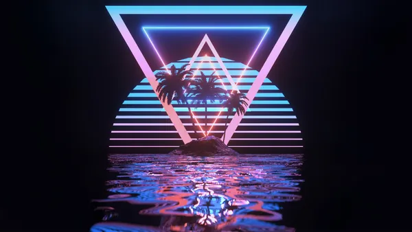
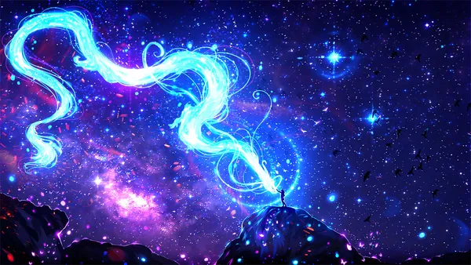
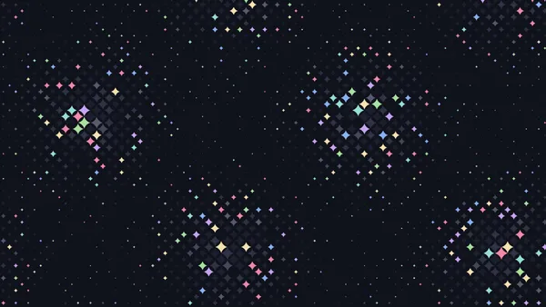
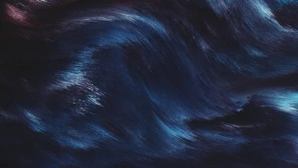
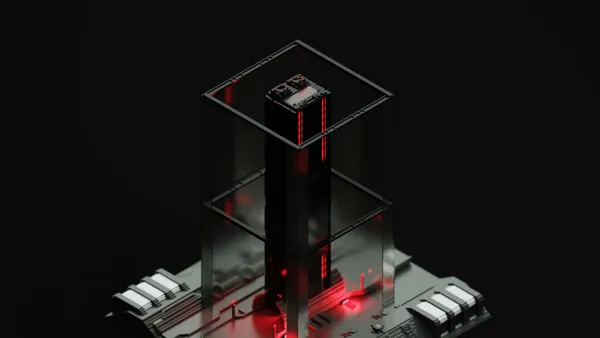

<p align="center">
  
</p>

<p align="center">
  <a href="https://voidwalls.vercel.app"></a>
  
  
  
  
  
  
  
</p>

---

```
  ██    ██  ██████  ██ ██████  ██    ██    ██     ██  █████  ██      ██      ███████ 
  ██    ██ ██    ██ ██ ██   ██ ██    ██    ██     ██ ██   ██ ██      ██      ██      
  ██    ██ ██    ██ ██ ██   ██ ██    ██    ██  █  ██ ███████ ██      ██      ███████ 
   ██  ██  ██    ██ ██ ██   ██  ██  ██     ██ ███ ██ ██   ██ ██      ██           ██ 
    ████    ██████  ██ ██████    ████       ███ ███  ██   ██ ███████ ███████ ███████ 
                              [ 虚無 // SCORCHED EARTH ]
```

# VOID//WALLS (虚無)

> *"Tired of corporate wallpaper apps filled with telemetry, tracking cookies, subscription paywalls, and melted AI slop? So were we. We scorched the earth. Pure uncompressed 4K, 60 FPS motion loops, procedural cyber radio, a Linux ricing forge, true AMOLED black-crushing, and zero compromise."*

**VOID//WALLS** is an underground, non-AI-slop, hyper-optimized, razor-sharp cyber-brutalist wallpaper vault, audio workstation, and ricing studio. Built for ricing enthusiasts (`r/unixporn`), terminal dwellers, mobile OLED users, and power users who despise bloat.

🌐 **Live Production Web App:** [https://voidwalls.vercel.app](https://voidwalls.vercel.app) *(Mirrored at [https://void-walls.vercel.app](https://void-walls.vercel.app))*

---

## ⚡ KEY FEATURE MATRIX

```
┌────────────────────────────────────────────────────────────────────────────────────────┐
│                              VOID//WALLS CORE CAPABILITIES                             │
├─────────────────────────┬──────────────────────────────────────────────────────────────┤
│ 1. 10-Station Cyber     │ 24/7 darksynth, cyber electro, and drum & bass live streams  │
│    Radio HUD            │ with automatic procedural Web Audio failover synths.         │
│                         │ Zero audio dropouts, real-time oscilloscope & spectrum analyzer│
├─────────────────────────┼──────────────────────────────────────────────────────────────┤
│ 2. The Unix Rice Forge  │ Instantly convert any wallpaper into ANSI ASCII art          │
│    (r/unixporn Studio)  │ (TrueColor 24-bit RGB) ready for fastfetch, neofetch, or motd│
│                         │ + 1-click dotfile exporters for Hyprland, Kitty, Alacritty,  │
│                         │ Pywal colors.json, and Waybar style.css.                     │
├─────────────────────────┼──────────────────────────────────────────────────────────────┤
│ 3. Cyber Studio &       │ Interactive 120Hz GPU-composited image workshop. Force       │
│    AMOLED Black Crusher │ near-black pixels to pure #000000 to shut off OLED pixels and│
│                         │ save phone battery. CRT scanlines, vignette & custom export. │
├─────────────────────────┼──────────────────────────────────────────────────────────────┤
│ 4. Cyber Pomodoro       │ 25m Deep Work / 5m Reboot / 15m Cooldown tactical timer      │
│    Focus HUD            │ with procedural synth chimes, cycle counter, and live        │
│                         │ persistent footer ticker badge.                              │
├─────────────────────────┼──────────────────────────────────────────────────────────────┤
│ 5. Portable Stash Vault │ 100% private, zero-cookie client-side vault sync. Download   │
│    & Sync Engine        │ JSON backup files, generate compact Base64 sync strings, and │
│                         │ share collections directly via mobile AirDrop / messaging.   │
├─────────────────────────┼──────────────────────────────────────────────────────────────┤
│ 6. Device Mockups &     │ Preview wallpapers inside simulated iPhone (Dynamic Island)  │
│    Desk Kiosk Mode      │ or MacBook frames. Full-screen ambient desk kiosk with       │
│                         │ lockscreen clock, oscilloscope, and lo-fi radio.             │
└─────────────────────────┴──────────────────────────────────────────────────────────────┘
```

---

## 🖼️ CURATED SHOWCASE (67 UNIQUE VAULTS)

Click any preview below to open that live collection on **VOID//WALLS**:

| [**Misc Vault (4K)**](https://voidwalls.vercel.app/#collection/misc) | [**Cyberpunk Night City**](https://voidwalls.vercel.app/#collection/cyberpunk) | [**Hypercars & Speed**](https://voidwalls.vercel.app/#collection/cars) |
| :---: | :---: | :---: |
| [](https://voidwalls.vercel.app/#collection/misc) | [](https://voidwalls.vercel.app/#collection/cyberpunk) | [](https://voidwalls.vercel.app/#collection/cars) |
| **`misc/` (4K UHD)** | **`cyberpunk/` (4K UHD)** | **`cars/` (4K UHD)** |

| [**Japanese Aesthetic**](https://voidwalls.vercel.app/#collection/japanese) | [**Deep Cosmic Space**](https://voidwalls.vercel.app/#collection/space) | [**Anime & Vistas**](https://voidwalls.vercel.app/#collection/anime) |
| :---: | :---: | :---: |
| [](https://voidwalls.vercel.app/#collection/japanese) | [](https://voidwalls.vercel.app/#collection/space) | [](https://voidwalls.vercel.app/#collection/anime) |
| **`japanese/` (4K UHD)** | **`space/` (4K UHD)** | **`anime/` (4K UHD)** |

| [**Catppuccin Palette**](https://voidwalls.vercel.app/#collection/catppuccin) | [**Tokyo Night**](https://voidwalls.vercel.app/#collection/tokyo-night) | [**Linux Workstations**](https://voidwalls.vercel.app/#collection/linux-desktop) |
| :---: | :---: | :---: |
| [](https://voidwalls.vercel.app/#collection/catppuccin) | [](https://voidwalls.vercel.app/#collection/tokyo-night) | [](https://voidwalls.vercel.app/#collection/linux-desktop) |
| **`catppuccin/` (Pastel Dark)** | **`tokyo-night/` (Midnight Blue)** | **`linux-desktop/` (Workstations)** |

---

## 📻 10-STATION CYBER RADIO HUD

Integrated directly into the bottom control drawer is an off-thread Web Audio radio receiver with real-time spectrum analysis, procedural noise mixers, and dual failover redundancy:

```
[01] NIGHTRIDE // RETRO_SYNTH   [24/7 STREAM]  Synthwave · Outrun · Retrowave
[02] CHILLSYNTH // CYBER_LOFI   [24/7 STREAM]  Downtempo Chill · Cyber Lofi Beats
[03] THE_GRID // DARKSYNTH      [24/7 STREAM]  Heavy Darksynth · Industrial Cyber Bass
[04] DATAWAVE // CYBER_ELECTRO  [24/7 STREAM]  Cyber Electro · Darkwave · Future Beats
[05] OVERDRIVE // CYBER_DNB     [24/7 STREAM]  High-BPM Drum & Bass · Heavy Basslines
[06] CYBER_DRONE // AMBIENT     [PROCEDURAL]   55Hz Deep Sine Sub-Bass Drone
[07] LOFI_TAPE // VINYL_WARMTH  [PROCEDURAL]   Analog Chord Pad · Pitch Wow & Flutter
[08] ANIME_DREAM // ARPEGGIO    [PROCEDURAL]   Pentatonic Cyberpunk Bell Arpeggiator
[09] INDUSTRIAL // SUB_PULSE    [PROCEDURAL]   80 BPM Distorted Cyber Kick Rhythm
[10] SYNTHWAVE // BASS_RUNNER   [PROCEDURAL]   115 BPM Sawtooth Outrun Bassline
```

> [!TIP]
> **Zero Audio Dropouts:** Stations 01–05 connect to ultra-low latency Icecast streams. If network conditions degrade or an external stream drops, our watchdog instantly shifts playback into matching procedural synthesizers—audio never cuts out.

---

## 🛠️ THE UNIX RICE FORGE (`[RICE]` / `P`)

The ultimate bridge between wallpaper aesthetics and terminal ricing:

### 1. Real-Time ANSI ASCII Art Renderer
- Converts any wallpaper into a retro terminal ASCII art text block in $< 2\text{ms}$.
- **Phosphor Modes:** `TRUECOLOR (24-bit RGB)`, `CYBER_CYAN`, `PHOSPHOR_GREEN`, and `AMBER_CRT`.
- **Widths:** `40c` (mobile/compact), `60c` (balanced), `80c` (full terminal).
- **1-Click Copy:** Copies raw ANSI escape codes (`\x1b[38;2;R;G;Bm`). Run `cat wallpaper.txt` in your terminal or paste directly into `fastfetch` / `neofetch` / `~/.bashrc` motd banners!

### 2. Linux Dotfile Generator Matrix
Extracts a 16-color harmonic palette and generates ready-to-paste configuration files:
- **Hyprland (`hyprland.conf`)**: Window border gradients with active/inactive alpha (`col.active_border = rgba(...) rgba(...) 45deg`).
- **Kitty (`kitty.conf`)**: 16-color terminal theme with foreground, background, selection, and cursor definitions.
- **Alacritty (`alacritty.toml`)**: Modern TOML color tables for normal and bright colors.
- **Pywal (`colors.json`)**: Universal Pywal schema compatible with Waybar, Rofi, Wofi, and Dunst.
- **Waybar (`style.css`)**: Dynamic CSS variables (`@define-color bg`, `@define-color accent`, etc.).
- **CSS Root Variables (`:root`)** and raw **HEX / RGB** arrays.

---

## 📱 CYBER STUDIO & AMOLED BLACK CRUSHER (`[STUDIO]` / `C`)

Engineered specifically for OLED mobile displays and desktop perfectionists:

- **True `#000000` Black Crusher:** Slider that sets low-luminance near-blacks to pure `0x000000`. On AMOLED/OLED screens, these pixels turn physically OFF, eliminating halo glow and saving 30%+ phone battery.
- **Real-Time 120Hz GPU Previews:** Visual adjustments run on GPU compositor layers (`contrast()`, `brightness()`) with zero main-thread canvas locking.
- **CRT Phosphor Scanlines:** Toggle arcade scanline grids directly onto the image.
- **Vignette & Contrast Tuning:** Enhance focal depth and neon punch.
- **On-Demand Canvas Export:** High-precision offscreen canvas compiles the final image only when tapping `[APPLY & DOWNLOAD]`.

---

## ⏱️ CYBER POMODORO FOCUS HUD (`[POMO HUD]`)

A dedicated cyberpunk focus timer built right into the carrier radio bar:

- **Interval Presets:**
  - `DEEP WORK`: 25:00 minutes of concentrated output.
  - `REBOOT`: 05:00 minutes protocol recalibration.
  - `COOLDOWN`: 15:00 minutes deep system reset (after 4 cycles).
- **Hardware-Accurate Clock:** Uses delta timestamps (`Date.now()`) with zero interval drift even when tabs are backgrounded or phone screens turn off.
- **Procedural Chimes:** Audible tactical audio tones synthesized on-the-fly when cycles finish.
- **Ambient Ticker:** Persistent ticking badge in the bottom HUD (`POMO: 24:18`).

---

## 🔒 PORTABLE STASH & ZERO-COOKIE SYNC (`[SYNC / JSON]`)

Privacy isn't a setting; it's the foundation:

- **0 Cookies & 0 Remote Tracking:** Favorites are kept strictly client-side via `localStorage`.
- **Portable JSON Backups:** Export your entire stash as a `voidwalls-stash-YYYY-MM-DD.json` file.
- **Compact Base64 Sync Strings:** 1-click copy compact codes to transfer your collection between PC and mobile via Telegram, WhatsApp, Discord, or Signal.
- **Native Mobile Share:** 1-tap integration with iOS / Android share sheets (`navigator.share`).
- **Smart Deduplication:** Merges incoming backups with existing saved wallpapers seamlessly.

---

## ⌨️ KEYBOARD SHORTCUTS

| Shortcut | Action | Scope |
| :---: | :--- | :--- |
| <kbd>⌘</kbd> + <kbd>K</kbd> / <kbd>Ctrl</kbd> + <kbd>K</kbd> | Open Tactical Command Palette | Global |
| <kbd>←</kbd> / <kbd>→</kbd> | Previous / Next Wallpaper | Lightbox |
| <kbd>Enter</kbd> | Download Active Wallpaper Preset | Lightbox |
| <kbd>P</kbd> | Open Unix Rice Forge & ASCII Matrix | Lightbox |
| <kbd>C</kbd> | Open Cyber Studio & AMOLED Crusher | Lightbox |
| <kbd>F</kbd> | Toggle Cyber Focus Desk Mode (Clock + Visualizer) | Lightbox |
| <kbd>M</kbd> | Cycle Device Mockup Frame (None / Phone / Laptop) | Lightbox |
| <kbd>S</kbd> | Save / Remove from Stash Vault | Lightbox |
| <kbd>Esc</kbd> | Close Active Modal / Lightbox / HUD | Global |

---

## 🚀 LOCAL SETUP & DEVELOPMENT

Run Void Walls locally on your own machine in seconds:

```bash
# 1. Clone the repository
git clone https://github.com/vrsn001/void-walls.git
cd void-walls/app

# 2. Install dependencies (Clean, zero heavy external packages)
npm install

# 3. Start development server
npm run dev

# Or build for production
npm run build
npx next start -p 3000
```

Open [http://localhost:3000](http://localhost:3000) in your browser.

---

## 🖥️ CLIENT SETUP (LIVE WALLPAPERS ON YOUR RIG)

### Linux (Hyprland / Wayland / Sway)
Play 60 FPS video loops hardware-accelerated via `mpvpaper`:
```bash
mpvpaper -o "no-audio --loop" '*' ~/Downloads/wallpaper.mp4
```

For static wallpapers with smooth crossfades:
```bash
swww img ~/Downloads/wallpaper.png
# Or feh on X11:
feh --bg-fill ~/Downloads/wallpaper.png
```

### Windows
- **Live Video (60 FPS)**: Grab [Lively Wallpaper](https://rocksdanister.github.io/lively/) (Free & Open Source) or Wallpaper Engine on Steam. Drag & drop any downloaded `.mp4`.
- **Static 4K**: Right-click downloaded `.png` or `.webp` $\rightarrow$ *Set as desktop background*.

### macOS
Use [Plash](https://github.com/sindresorhus/Plash) or Aerial Screensaver to render live video backdrops directly on your macOS desktop.

---

## 🤝 UPSTREAM REPOSITORIES & ATTRIBUTION

We believe in radical open-source attribution. VOID//WALLS unites the finest open-source wallpaper collections on GitHub:

| Repository | Source / Creator | Content Contribution |
| :--- | :--- | :--- |
| **[`vrsn001/void-walls`](https://github.com/vrsn001/void-walls)** | *Based on [`dharmx/walls`](https://github.com/dharmx/walls)* | Core archive engine, 60 FPS motion loops, automated manifest generator. |
| **[`mylinuxforwork/wallpaper`](https://github.com/mylinuxforwork/wallpaper)** | *mylinuxforwork* | **220 Linux workstation backdrops**, 3D tech canvases, and dual-monitor art (`linux-desktop/`). |
| **[`michaelScopic/Wallpapers`](https://github.com/michaelScopic/Wallpapers)** | *michaelScopic* | **500+ Aesthetic backdrops**: Hypercars (`cars/`), Cyberpunk (`cyberpunk/`), Catppuccin (`catppuccin/`), Japanese (`japanese/`), Tokyo Night (`tokyo-night/`). |
| **[`vyrx-dev/Wallpapers`](https://github.com/vyrx-dev/Wallpapers)** | *vyrx-dev* | **AMOLED 9:16 Vertical phone backdrops** (`vertical/`), Nord dark palette, and pixel art. |
| **[`AlexandrosLiaskos/Awesome_Wallpapers`](https://github.com/AlexandrosLiaskos/Awesome_Wallpapers)** | *Alexandros Liaskos* | **382 Curated web gallery wallpapers** with aspect-ratio profiling (`awesome/`). |
| **[`DenverCoder1/minimalistic-wallpaper-collection`](https://github.com/DenverCoder1/minimalistic-wallpaper-collection)** | *Jonah Lawrence* | **336 Vector minimal landscapes** and clean desktop gradients (`minimalist/`). |

All wallpaper assets remain the intellectual property of their respective creators.

---

## 📜 LICENSE & ETHICS

- **Frontend & Workstation Code**: [MIT License](LICENSE). Free as in speech, free as in beer.
- **Wallpaper Assets**: Retain their original licenses and attribution to their upstream authors.
- **Privacy Standard**: 100% Client-Side. No cookies. No user tracking. No analytics beacons.

<p align="center">
  <b>VOID//WALLS</b> — <i>Built with ruthless precision by <a href="https://github.com/vrsn001">VRSN001</a>.</i>
</p>
